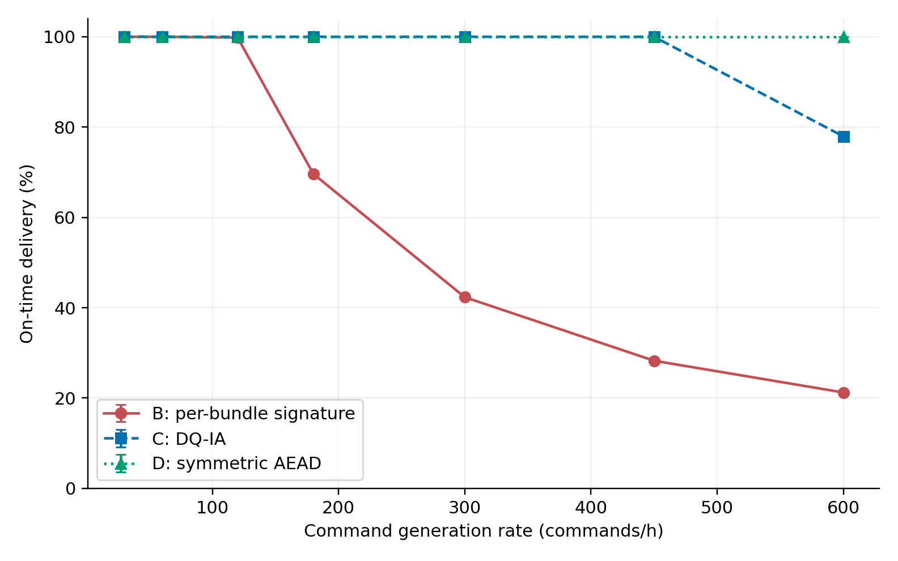

# DQ-IA 第六章本机实验

依据 `DQIA_chapter6_revised.pdf` 第 6.1–6.3 节，实现普通电脑可运行的 Python 离散事件仿真。
网络仿真保留逐束签名 B、DQ-IA C 和纯对称 AEAD D 三组；真实密码原型另作为独立实验，尚未开展形式化安全验证。

> 本分支另增加了 [Ubuntu 22.04 / Python 3.10 真实密码协议与抗重放测试](experiments/protocol/README.md)。
> 下文及 `experiments/chapter6/` 的网络仿真不执行真实密码运算；协议原型属于独立实验，安装及运行命令请用上述专门说明，尚不包含形式化安全验证。

> [ProVerif 2.05 形式化验证模型与 Ubuntu 运行说明](experiments/proverif/README.md) 已提供；[首轮有效查询](experiments/proverif/PROGRESS.md)中部分有限状态单射认证仍无法证明，不能称全部形式化验证通过。

## 实验结果与仓库结构

本仓库包含完整实验代码及约 84 MB 的运行证据，无需 Git LFS。
已完成 432 组运行、12 项本地测试，并审计 2,581,194 条指令记录。

- [中文实验结果与论文描述](experiments/chapter6/results/实验结果说明.md)
- [全部逐运行指标](experiments/chapter6/results/network_results.csv)
- [配对差值与 95% 置信区间](experiments/chapter6/results/paired_differences.csv)
- [审计记录](experiments/chapter6/results/audit.json)
- [开发、分支与数据管理约定](CONTRIBUTING.md) · [版本记录](CHANGELOG.md)

|负载（条/h）|B 平均期限内交付率|DQ-IA 平均期限内交付率|D 平均期限内交付率|
|---:|---:|---:|---:|
|60|100%|100%|100%|
|180|69.626%|100%|100%|
|300|42.334%|100%|100%|
|600|21.233%|77.939%|100%|

结果支持在本文指定模型下，DQ-IA 相比逐束签名基线以更短报文提高中高负载时的及时交付能力；不证明密码安全性或真实深空部署性能，也不表明其带宽效率优于纯对称方案 D。



```text
DQ-IA/
├── .github/workflows/validate.yml  # 跨平台测试和原始记录审计
├── README.md                      # 复跑说明与实验口径
├── CONTRIBUTING.md                # 分支、提交和数据约定
├── CHANGELOG.md
├── experiments/chapter6/
│   ├── simulation.py              # 共用调度器
│   ├── run.py                     # 完整实验入口
│   ├── report.py                  # 统计与绘图
│   ├── audit.py                   # 原始证据审计
│   ├── requirements.txt           # 已验证的依赖版本
│   └── results/                   # 固定实验快照，含完整原始记录
└── tests/test_chapter6.py
```

下载或克隆仓库后进入根目录：

```bash
git clone https://github.com/liuyishan66666/DQ-IA.git
cd DQ-IA
```

## 本机运行

已使用 Python 3.12.14 验证。建议 Python 3.12，Windows、macOS、Linux 均可；不需要 Ubuntu 虚拟机、GPU 或开发板。
在本项目根目录执行以下命令。仿真核心和测试只依赖 Python 标准库；统计与绘图依赖 requirements.txt 中的包。

Windows PowerShell（直接调用虚拟环境解释器，无需修改执行策略）：

```powershell
py -3.12 -m venv .venv
.\.venv\Scripts\python.exe -m pip install -r experiments/chapter6/requirements.txt
.\.venv\Scripts\python.exe -m unittest discover -s tests -v
.\.venv\Scripts\python.exe -m experiments.chapter6.run --output experiments/chapter6/results_local
```

macOS / Linux：

```bash
python3.12 -m venv .venv
.venv/bin/python -m pip install -r experiments/chapter6/requirements.txt
.venv/bin/python -m unittest discover -s tests -v
.venv/bin/python -m experiments.chapter6.run --output experiments/chapter6/results_local
```

运行的是模拟时间，无需等待现实中的 24 小时。程序拒绝覆写非空输出目录，重跑时选择新的 `--output` 路径。
已经实际完成的完整证据位于 `experiments/chapter6/results/`，随仓库一同分发。
代码与图表只在云 Linux 中验证过；以上 Windows/macOS 命令为本机复跑说明，未在这两种系统实际执行。

## 固定实验设计

|参数|值|
|---|---|
|B / C / D 束长|4485 / 1208 / 104 B|
|业务明文 / 示例协议头|32 / 40 B；协议头是解析假设|
|有效带宽|2000 bit/s|
|接触 / 间歇|2700 / 1800 s，从 t=0 起周期重复|
|单程传播|780 s|
|生成时段|[0, 86400 s)|
|到达期限|自生成起 5400 s 内到达，含等号|
|队列|FCFS、无上限、不抢占、不跨窗口分段|
|连续负载|30、60、120、180、300、450、600 条/h|
|固定种子|2026102501–2026102520，共 20 个，每个负载三组共用清单|
|突发批量|每个接触起点 100、180、300、600 条，分别独立运行|
|突发注入次数|20 次；最后一次为 t=85500 s|
|其余|无误码、无重传、密码处理时间为零|

生成停止后继续原接触计划，直至全部交付或过期。吞吐量只计接收时刻落在 `[0,86400 s)` 的业务明文；最终交付率包含排空阶段及时到达的指令。
队首若在最早可行发送时刻也无法及时到达，立即在决策时移除并记为过期，不消耗发送时间。
队长是事件发生后的待发送数量，不含正在发送的指令；同一时刻事件合并。
整数纳秒计时，避免浮点累计造成窗口边界误判；泊松间隔用标准库 `random.Random(seed).expovariate(rate/3600)`，绝对生成时刻四舍五入至纳秒。

## 验证与统计口径

测试包括：无期限饱和容量 150/558/6490、单批 180 条、发送恰好结束于窗口边界、到达恰好等于期限与晚 1 ns、传播后到达落在地面接触外、24 h 后排空、跨窗口队列保留、不含发送中指令的队长，以及 30 组小场景与独立逐时刻调度器交叉对照。

单批 180 条时 C 发完用时 869.76 s，末条到达 1649.76 s。B 首窗口发完 150 条；启用 90 min 到达期限后，其余 30 条只有 6 条可以及时到达。
这一区别不能用“剩余指令全部在下一窗口交付”替代。

主运行逐组检查 `生成数=最终交付数+过期数`、发送互不重叠、整束处于接触内、到达期限和队列非负。
连续场景对每个种子分别计算指标，之后采用 19 个自由度的双侧 Student t 区间汇总 20 个种子。
差值按同一负载、同一种子配对计算；交付率与过期比例差值单位为百分点。
时延分位数使用线性插值 `(n−1)p`，只包括已交付指令；汇总表中的 P95 是“逐种子 P95 的均值”，不是合并样本的 P95。
突发场景确定性运行，不重复构造置信区间。
队列示例固定采用第一个种子 2026102501，避免挑选运行结果。

## 输出文件

- `network_results.csv`：432 组运行的全部指标。
- `continuous_summary.csv`：连续场景逐指标均值及 95% CI。
- `paired_differences.csv`：C−B、D−B、C−D 配对差值及 95% CI。
- `burst_results.csv`：突发对照表数据。
- `traffic/*.csv.gz`：每个场景共用的指令生成清单。
- `events/*.csv.gz`：每条指令的编号、生成/决策/发送开始/发送完成/到达时刻和最终状态，时间单位 ns；过期指令未发送，其发送与到达时间为空。
- `queues/*.csv.gz`：完整事件时序的队长，含排空阶段。
- `figures/*.{png,pdf,svg}`：负载–交付率、负载–吞吐量、120 和 300 条/h 队列图；英文坐标避免本机缺少中文字体。
- `config.json`：参数、种子、环境版本、PDF SHA-256 及仿真源码校验摘要。
- `实验结果说明.md`：根据实际运行数据生成的中文结果及可用于论文的描述。
- `audit.json` / `audit_manifest_sha256.csv`：另行审计生成的校验结果及产物摘要（运行下方命令）。

独立核对已保存的日志：

```bash
python -m experiments.chapter6.audit experiments/chapter6/results
```

本次工作不包含 ProVerif、实际 BPSec 编码/互操作、密码耗时、星载 RAM/能耗、掉电恢复或真实信道性能验证。
论文修订稿没有要求 Ubuntu 专属主实验；ProVerif 如后续开展，需另行实现完整模型并保留工具日志。
分支采用 `main` 与 `experiments/chapter6`，首次固定快照标记为 `v0.1.0`。详见 [CONTRIBUTING.md](CONTRIBUTING.md)。
